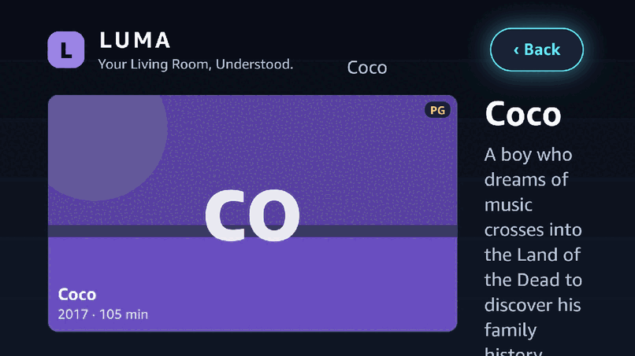
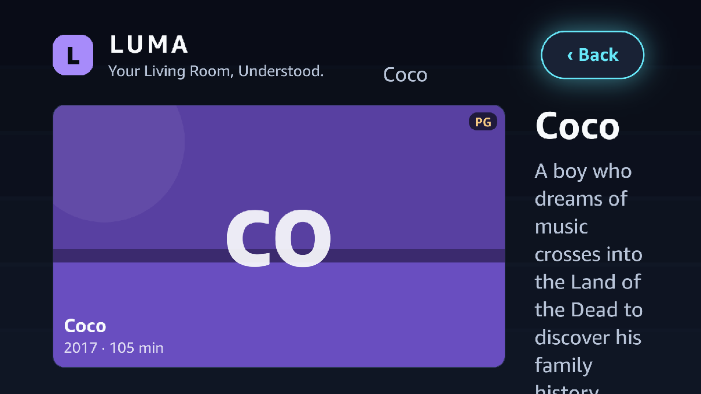
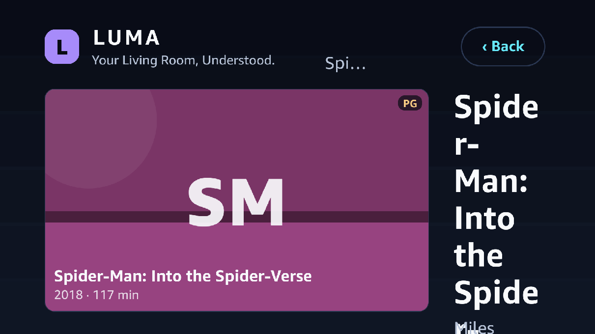
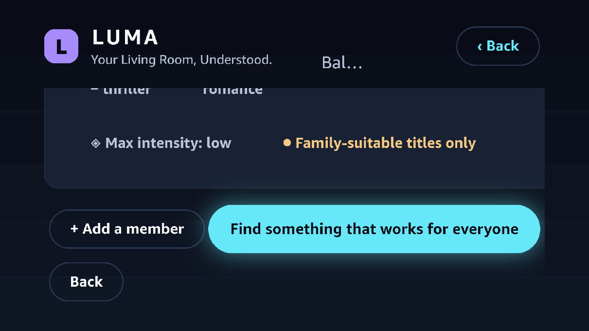
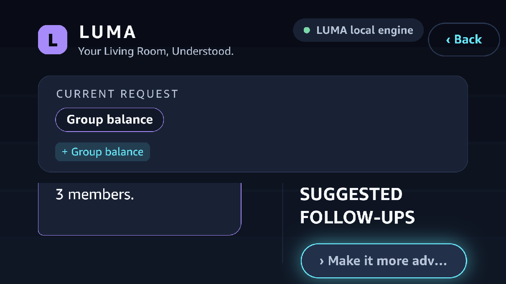
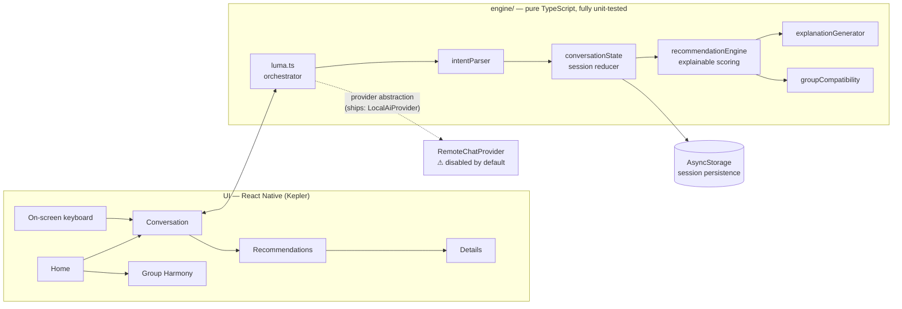

<div align="center">

# LUMA — Your Living Room, Understood

**A conversational TV entertainment companion for Amazon Vega OS / Fire TV.**

You describe what you want in plain language. LUMA keeps the constraints you want to keep,
recommends **at most three** titles — and explains exactly *why* each one fits.

*Fully offline · deterministic · honest about what it doesn't know · zero fake integrations*

[](#-actual-test-results)
[](#-actual-test-results)
[](#-on-device-verification-vega-virtual-device-x86_64)
[](#-architecture)
[](#honest-disclosures)
[](#-no-new-npm-dependencies)
[](https://github.com/RespectedBibaswanSarkar/LUMA/actions/workflows/ci.yml)



<sub>The reel above is real footage — screenshots taken from the running app on the Vega Virtual Device while injecting D-pad keys, not mockups.</sub>

</div>

---

## Table of contents

- [The idea](#-the-idea)
- [What's on screen](#-whats-on-screen)
- [How a conversation works](#-how-a-conversation-works)
- [Quick start](#-quick-start)
- [Actual test results](#-actual-test-results)
- [On-device verification (Vega Virtual Device, x86_64)](#-on-device-verification-vega-virtual-device-x86_64)
- [Remote controls](#-remote-controls)
- [Architecture](#-architecture)
- [Design system — “Midnight Cinema"](#-design-system--midnight-cinema)
- [Honest disclosures](#honest-disclosures)
- [Known limitations](#known-limitations)
- [Demo](#demo)

---

## 💡 The idea

Movie night fails the same way every week: five people, vague wishes, a wall of thumbnails,
and no one can explain why anything is a good pick. **LUMA turns plain language into three
real picks with reasons** — and when it doesn't know something, it says so instead of
guessing.

| | |
| --- | --- |
| 🗣️ **Plain language in** | *"An adventurous family movie night, nothing too scary, under two hours"* |
| 🧠 **Context kept** | Follow-ups only change what you say: *"Make it more adventurous, keep everything else"* |
| 🎯 **≤ 3 picks out** | Deterministic scores (0–100), per-title reasons, satisfied / unverified / failed constraints |
| 🪞 **Honesty built in** | Unverified metadata is shown as *not verified* — and **lowers** a score instead of passing it |
| 🏝️ **Works offline** | The whole engine is local, deterministic TypeScript. No API key, ever |
| 👨‍👩‍👧 **The whole room** | Group Harmony models 2–5 people — likes, avoids, intensity ceilings — with per-member trade-offs |

---

## 📺 What's on screen

| Home / Discover | Conversation |
| :---: | :---: |
|  |  |
| Voice-ready entry, one-press requests, featured catalogue, recently explored | Request restated with change badges, LUMA's reply, follow-ups, actions rail, on-screen keyboard |

| Recommendations | Content Details |
| :---: | :---: |
|  |  |
| Max 3 cards, scores, per-title reasons, *what was filtered out and why* | Only facts the catalogue really holds — including the **“Not verified by LUMA"** rows |

Plus:

- **Group Harmony** — 2–5 fictional members (likes / avoids / intensity ceiling /
  family-suitable toggle), instant compatibility preview with per-member trade-offs.
- **Session memory** — follow-ups preserve constraints, every change is visible as a
  `+ / − / ⇄ / ↑ / ↓` badge, and **Clear session** resets everything, visibly.

---

## 💬 How a conversation works

Every exchange below is produced by the shipped local engine (and asserted by the test
suite — same input, same output, every time):

```text
YOU     An adventurous family movie night, nothing too scary, under two hours
LUMA    Got it: adventure, family-suitable, nothing frightening, ≤ 120 min.
        3 picks below — each with the reason it fits.
        [ UP NEXT ] Make it more adventurous, keep everything else
                    Something shorter, still family-friendly
                    A crowd-pleaser with a great cast

YOU     Make it more adventurous, keep everything else      ← follow-up
LUMA    Kept: family-suitable, nothing frightening, ≤ 120 min.
        Changed: ↑ adventure                          [badges shown]
        3 picks below — each with the reason it fits.
```

An unrecognised request gets a **clarification, not a guess**; a bare modifier
(*"make it scarier"* with no base request) asks what to start from; *"instead"* replaces
only the swapped constraint and keeps the rest.

---

## 🚀 Quick start

### Environment (verified on this build)

| Component | Version / value |
| --- | --- |
| Node · npm | v22.14.0 · 10.9.2 |
| Vega CLI · SDK | 1.4.5 · 0.24.12112 |
| React Native | 0.83 via `@amazon-devices/react-native-kepler` 4.0.1 |
| Target | tv / x86_64 (Vega Virtual Device), manifest OS 1.2 |
| App id | `com.luma.livingroom` (interactive component `com.luma.livingroom.main`) |
| Package | `@amazon-devices/luma`, vpkg ≈ 1.2 MB |

<details>
<summary><b>Install the Vega CLI/SDK</b> (skip if <code>vega</code> is already on your PATH)</summary>

```bash
npm install -g @amazon-devices/vega-cli
vega sdk install
export PATH="$HOME/vega/bin:$PATH"    # typical install location
```
</details>

### 1 · Test (no device needed)

```bash
npm install
npm test              # jest — 6 suites, 70 tests
npx tsc --noEmit      # strict TypeScript
npm run lint          # eslint — 0 errors
```

### 2 · Build

```bash
npm run build:release               # react-native build-vega (Release) — prints the vpkg path
python3 scripts/fix-ntfs-vpkg.py    # REQUIRED after every rebuild on ntfs3 mounts (see note)
```

<details>
<summary><b>Why these two foot-guns exist</b> (build:release · fix-ntfs-vpkg.py)</summary>

- **`build:release`, not `vega build`** — `react-native build-vega` produces the Hermes JS
  bundle; the plain `vega build` path skips it and yields a broken package.
- **`fix-ntfs-vpkg.py`** — on Linux *ntfs3* mounts, files smaller than one 4 KiB cluster
  report `st_blocks = 0`. The Vega packer treats zero-block files as sparse, packs them with
  size 0, and the device then rejects the package (“digest mismatch"). The script forces a
  cluster allocation **without changing content**, re-packs, and validates. It reads the
  package name from `package.json` (rename-safe) and is a no-op on ext4/btrfs.
</details>

### 3 · Run on the Vega Virtual Device

```bash
vega virtual-device start -t 180                          # boot (~1 min)

vega run-app \
  "build/private/kepler/@amazon-devices/luma/undefined/vega/x86_64/Release/@amazon-devices/luma_x86_64.vpkg" \
  com.luma.livingroom.main --deviceId VirtualDevice

vega device is-app-running -a com.luma.livingroom.main    # → "is running"
```

> **Debug:** `vega device start-log-stream` for device/system logs. React Native
> `console.log` is **not** forwarded in release builds on this SDK — rely on the unit tests
> and screen-level verification instead. The virtual-device shell is minimal
> (no `adb`, `dumpsys`, `screencap`, `input`); the SDK ships `vda` (adb-compatible).

---

## ✅ Actual test results

Executed on the final tree — not aspirational:

```text
PASS test/intentParser.spec.ts
PASS test/recommendationEngine.spec.ts
PASS test/conversationState.spec.ts
PASS test/groupCompatibility.spec.ts
PASS test/aiProvider.spec.ts
PASS test/scenarios.spec.ts

Test Suites: 6 passed, 6 total
Tests:       70 passed, 70 total
Time:        0.422 s
```

```text
npx tsc --noEmit      → clean (exit 0)
npm run lint          → 0 errors, 13 warnings (style hints + SDK informational notes)
```

<details>
<summary><b>What the 70 tests actually cover</b></summary>

- floors/ceilings in words *and* digits (“under two hours” ⇔ `≤ 120`),
- family suitability, frightening-content exclusions, explicit genre exclusions,
  intensity ceilings, languages;
- clarifications instead of guessing — including the bare-modifier case
  (“make it scarier” with no base request);
- **determinism**: same request ⇒ same order, always;
- explainable ranking: per-title reasons, satisfied/unverified/failed constraints,
  filtered-out lists with reasons;
- unknown-metadata honesty: never invented, never counted as a pass, *lowers* the score;
- group scoring: per-member satisfaction, trade-offs, ≤ 100 cap;
- follow-up context preservation, replacement semantics (“instead” keeps everything else),
  session reset;
- invalid/empty remote-AI output ⇒ fallback to the local engine.
</details>

### 📡 On-device verification (Vega Virtual Device, x86_64)

The app was driven **for real** on the emulator: D-pad/OK/Back keys injected into the
emulator window (XTest), with every transition proven by pixel-diffing screenshots —
the screenshots in this README are frames from that session.

| Step | Evidence (pixel diff vs. previous frame) |
| --- | --- |
| Install → launch → render | `com.luma.livingroom.main` running, stable pid, **zero JS errors** |
| Home · focus ring moves | `Down` → **110 647 px** changed (ring between suggestion chips) |
| OK on a suggestion | Conversation opens & auto-sends → **458 542 px** |
| Conversation · rail nav | `Down/Up/Right` move focus (**50–257 K px** per step) |
| See recommendations | Recommendations renders (**467 126 px**) — ≤ 3 cards, score badges |
| OK on a card → Details | **319 303 px** |
| Back → Back → Back | 277 K → 433 K → 459 K — full stack pop to Home |
| Focus restored on Back | the post-back `Down` diff (**257 306 px**) is *identical* to the pre-back one |

<details>
<summary><b>Bugs found only on-device (and fixed)</b> — unit tests couldn't catch these</summary>

1. **No focus anchor after a route push** — ConversationScreen claimed no initial focus, so
   every further D-pad press was silently ignored. It now defaults focus to the first
   follow-up chip, like every other screen.
2. **`hasTVPreferredFocus` is not enough on relaunch** — the system default-focus pass does
   not reliably run when the app relaunches into an already-focused window, leaving the
   D-pad with no anchor at all. `Focusable` now also claims `focus()` for its preferred
   element on mount (retried, crash-safe), making initial focus deterministic on every screen.
3. **Release-build logging trap** — RN `console.log` neither reaches
   `vega device start-log-stream` nor is safe to lean on in release bundles on this SDK.
   Removed; the README documents the real debugging paths instead.
</details>

---

## 🎮 Remote controls

Everything in LUMA is operable with a standard Fire TV remote:

| Remote | Action in LUMA |
| --- | --- |
| **D-pad** | Move the focus ring (chips, cards, rail, keyboard) |
| **OK / Select** | Activate — send a suggestion, open a card, cycle a preference |
| **Back** | Pop one screen; restore the previous screen's focus; at Home, exits (platform default) |

The TV text input is a **custom on-screen QWERTY keyboard** — the Vega runtime provides no
system keyboard to the React Native layer, so LUMA ships its own, fully D-pad-driven.

---

## 🧩 Architecture



```text
src/
  engine/                     Pure TypeScript — no React, no RN. 70 unit tests.
    catalogue.ts                  45 real titles; honest metadata (unknown stays unknown)
    intentParser.ts               plain language → structured intent, follow-up aware
    recommendationEngine.ts       explainable scoring, determinism, exclusion reasons
    groupCompatibility.ts         per-member satisfaction + trade-offs + group score
    conversationState.ts          session reducer: apply / reset / recents / memory
    explanationGenerator.ts       constraints → human sentences
    aiProvider.ts                 provider abstraction + schema validation + fallback
    luma.ts                       utterance in → state + reply + matches out
    scenarios.ts                  scripted end-to-end scenarios (also tested)
  config/ai.local.ts         remote-AI config — ships DISABLED (enabled: false)
  state/AppProvider.tsx      session + status (idle/processing/error) + persistence
  navigation/routes.ts       explicit stack navigator (~80 lines) + focus memory
  components/                Focusable · Poster · Shell · MessageList ·
                             OnScreenKeyboard · VoicePanel
  screens/                   Home · Conversation · Recommendations · Details · GroupHarmony
  theme/tokens.ts            Midnight Cinema design tokens
test/                        6 jest suites · 70 tests
scripts/fix-ntfs-vpkg.py    ntfs3 zero-block packaging workaround
```

**Why hand-rolled?** The Kepler package ships only `react-native` +
`@amazon-devices/react-native-kepler` (TVFocusGuideView, TVEventHandler, FocusManager,
AsyncStorage, BackHandler, TextInput). No navigation or UI library is needed — the stack
navigator is ~80 lines of explicit state with per-screen focus memory, and TV text entry is
a custom keyboard because the runtime offers none.

---

## 🎨 Design system — “Midnight Cinema"

| Token | Value | Use |
| --- | --- | --- |
| Background | `#080B14` | Base |
| Surface | `#192235` | Panels, chips, bubbles |
| Accent | `#A78BFA` | Brand, emphasis |
| Interactive | `#67E8F9` | **Focus ring**, primary actions |
| Highlight | `#F5C982` | Scores, key facts |
| Text | `#F8FAFC` / `#B8C4D8` | Primary / secondary |

16:9, TV-scale type, a visible focus ring on every interactive element, pure React Native
views (no DOM/CSS APIs). Poster art is **generated on-device** from each title's own data
(deterministic gradient + monogram) — nothing is hot-linked, so the app never fails offline
and carries no artwork-licensing exposure.

---

## Honest disclosures

<details>
<summary><b>1 · No fake microphone — voice is “voice-ready”, not simulated</b></summary>

SDK 0.24.12112 exposes **no microphone or speech-recognition API** to React Native. LUMA
does not simulate listening. The voice panel states this in-app and offers the working
inputs (suggested phrases + on-screen keyboard). No voice-provider module exists yet; a real
recognizer requires a supported platform API. `src/engine/aiProvider.ts` is the pattern used
for the separate text-understanding provider abstraction.
</details>

<details>
<summary><b>2 · No playback / streaming integration</b></summary>

LUMA is a discovery companion; the Details screen says so explicitly. No fake “Play" button
— a dead button is worse than an honest “playback is not connected".
</details>

<details>
<summary><b>3 · Remote AI exists — and ships disabled</b></summary>

The default engine is 100 % local and deterministic. `RemoteChatProvider` (OpenAI-compatible)
is implemented behind a provider abstraction and disabled in the shipped
`src/config/ai.local.ts` (`enabled: false`); credentials are read from environment/config
**outside source control**. If enabled and it ever fails or returns malformed output, the
app falls back to the local engine **and says so in the UI**.
</details>

<details>
<summary><b>4 · No invented metadata</b></summary>

The catalogue holds only facts actually known about each real film. Anything unverified is
stored as `unknown`, shown as “not verified" — and unverifiable constraints **lower** a
score instead of passing it.
</details>

<details>
<summary><b>5 · No third-party artwork</b></summary>

Posters are generated locally from title data.
</details>

<details>
<summary><b>6 · No new npm dependencies</b></summary>

Pure `react-native` + `@amazon-devices/react-native-kepler`. That's the whole dependency
tree the app adds.
</details>

---

## Known limitations

- **App icon** — not set (the manifest build warns and uses the system default).
- **Voice input** — blocked on a platform API (disclosure 1). Everything else is
  remote-driven today.
- **Catalogue** — a curated 45-title offline sample with honest metadata; no live
  catalogue/availability feed is connected.
- **Keyboard** — QWERTY grid, D-pad driven; no autofill/predictive text.
- **ntfs3 mounts** — on this build machine the project lives on ntfs3, so
  `python3 scripts/fix-ntfs-vpkg.py` must run after every rebuild (no-op on ext4/btrfs).
- **Test tooling** — the SDK ships no `input`/`screencap` for the virtual device; the
  on-device verification harness (X11 XTest + ImageMagick) lives in `/tmp` and is **not
  part of the app**.
- **Back at Home** follows the platform default (leaves the app) — standard Fire TV
  behaviour.
- Official Vega docs were unreachable from the build environment; everything was derived
  from the installed SDK, its types, and the template.

---

## Demo

A 3-minute judged demo flow (hook → conversation & follow-ups → recommendations &
honesty → group harmony → memory & reset → close), with backup beats and judge Q&A, lives
in [`DEMO_SCRIPT.md`](DEMO_SCRIPT.md).

---

<div align="center">
<sub>
LUMA · built for the Amazon Build, Ship &amp; Shape Hackathon · runs on Amazon Vega OS / Fire TV<br/>
Offline-first · deterministic · honest about what it doesn't know
</sub>
</div>
